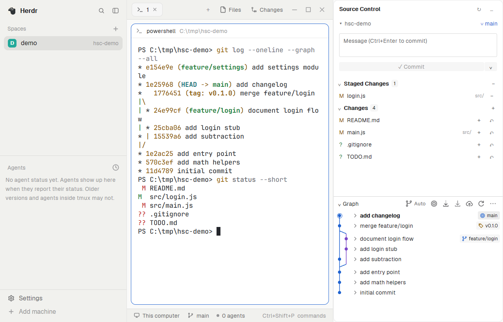

# Source Control for Herdr

A Git panel for the [Herdr](https://herdr.dev) desktop app, modeled on VS Code's
Source Control view. It follows the focused terminal's repository: stage and
unstage files or single lines, commit (amend, sign-off, commit & push), push,
pull and sync, manage branches, stashes, tags and worktrees, resolve merge
conflicts, and browse a commit graph with branch, tag and remote badges.



## Install

Ask your agent in Herdr:

> add herdr.dev/mods/photojupi/herdr-source-control

Or by hand: copy `mods/source-control` into `~/.config/herdr-app/mods/`.

Herdr docks a new mod only while one of your own layouts is shown, not a
shipped one like `main`. Clone it first, then copy the folder:

```sh
herdr-app do layout.clone '{"name":"main","as":"my-main"}'
```

The panel appears as a 360px column on the right edge of the window. To put
it somewhere else, add a block with `"content": { "mod": "source-control" }`
to your layout. `RECIPE.md` has the details.

Before installing, know that the panel runs `git` (on this computer, or on a
remote machine for spaces there, including fetch/pull/push), writes temporary
patch files under Herdr's `data/` folder, and reads and writes files in the
repositories it manages.

## Requirements

- Herdr app 0.1.15 or newer
- `git` on PATH (on every machine you use it with)

## Limits

Line-level staging is for ordinary text changes, remote machines support
whole-file operations only, and Git commands time out after 30 seconds. See
[the mod's README](mods/source-control/README.md#limits) for the full list.

## License

Apache-2.0, see [LICENSE](LICENSE).
