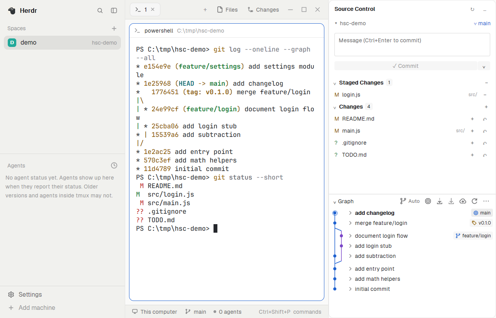

# Source Control

A Git panel docked on the right edge of the Herdr window, in the style of VS
Code's Source Control view. It shows the repository of the focused terminal:
its branch, a commit box, the staged, unstaged and conflicted files, and below
a resizable divider a commit graph with branch, tag and remote badges. Clicking
a file opens its diff in a dialog where single lines or hunks can be staged,
unstaged or discarded; a conflicted file opens a three-way merge editor.

## What you see

The panel is one column, 360px wide at zoom 1, the full window height, to the
right of everything else. Its card has a 1px `border` line, 10px rounded
corners and the theme `background`; text is 12px in the theme's UI font,
`foreground` color. Top to bottom:

- **Title bar** (36px): "Source Control" in semibold, then on the right a
  `↻` Refresh button and a `…` More Actions button (24px tall, `muted`
  glyphs, `hover` background).
- **Upper area** (scrolls on its own):
  - Repository line (26px): `▾ <repo folder name>` in `muted` on the left
    (tooltip: the full path), and the branch on the right in `ansi4` as
    `⑂ main ↓1 ↑2` (behind/ahead shown only when nonzero), or
    `Detached <7-char hash>`.
  - An "Initialize Repository" button, only when the folder is not a repo.
  - Commit box: a 2-4 line auto-growing textarea, placeholder
    "Message (Ctrl+Enter to commit)", `surface` background, 1px `input`
    border, 3px corners. Under it a 28px row: the primary button (fills the
    width; `accent` background with `accent_foreground` text when enabled,
    `raised`/`dim` when not) and a 27px `⌄` options button on `raised`.
    The primary label is `✓ Commit`, or Publish Branch / Push / Sync Changes
    when there is nothing to commit; while working it shows the running
    action ("Committing", "Pushing", ...).
  - "<operation> in progress" in `ansi3` with an Abort button, during a
    merge, rebase, cherry-pick or revert.
  - File groups, in this order: **Merge Changes** (conflicts), **Staged
    Changes**, **Changes**. Each header (26px) has a `⌄`/`›` chevron, the
    title in semibold, a count pill (10px text on `raised`, 4px corners) and
    on the right `+` Stage All or `−` Unstage All. Empty groups are hidden,
    except Changes, which says "No changes". Each file row (26px): a status
    letter (`M`, `A`, `D`, `R`, `?` for untracked; `ansi2` for added and
    untracked, `ansi3` for others, `ansi1` in Merge Changes), the file name,
    its folder in 10px `dim` text (e.g. `src/`), then `+`/`−` and, in
    Changes, `↶` Discard. Tooltip: the full path (`old → new` for renames).
  - An output note (11px `muted`, up to 100px, scrolls) with a `×` to
    dismiss, after an action prints something.
- **Divider**: a horizontal split between the upper area and Graph. The
  upper part starts at 135px plus the height of the file rows (at most
  285px more), and is never smaller than 160px; Graph keeps at least 80px.
- **Graph** (fills the rest): a 30px toolbar with a 1px `border` line on top:
  `⌄ Graph` (click folds it), then 16px icon buttons: reference filter
  (branch icon + "Auto", "All", a branch name or "N refs"), Go to Current
  History Item (target), Fetch From All Remotes, Pull, Push (or Publish
  Branch when there's no upstream), Refresh, More Actions (`⋯`). Below, a
  virtual list of commits, 22px each, 6px rows for pure connector lines:
  lanes drawn with 7px dots and lines in `ansi4`, `ansi5`, `ansi2`, `ansi3`,
  `ansi6` (by lane); the HEAD commit's dot has an 11px `ansi4` ring and its
  subject is semibold. Each row: a `›`/`⌄` chevron, the subject (truncated),
  then badges (max 105px, 3px corners, `raised`, or `selected` for the
  current one): target icon in `ansi4` for the current local branch, branch
  icon `ansi4`, cloud icon `ansi5` for remote tips, tag icon `ansi3`, each
  with a 10px label and a count when several refs share it. Tooltip:
  subject, hash, author, date and refs. An expanded commit lists its changed
  files (file icon and status letter colored `ansi2` added, `ansi1` deleted,
  `ansi3` otherwise), as a flat list or as folders (chevron + folder icons,
  14px indent per level). "Load more…" appears after 200 commits.
- **Dialogs inside the panel**: menus, forms and confirmations cover the
  whole panel (absolute, `background`, 12px padding): a title with `×`, an
  optional description (11px `muted`), then 32px menu rows (a `✓` column in
  `ansi4` for checkable items, a right-side hint in 10px `dim`) or 32px
  input fields with a Cancel and an `accent` submit button.
- **Diff dialog** (Herdr dialog, 1100×740): a 44px header (file path,
  Refresh), a 42px action row ("Click changed lines or hunk headers to select
  them.", "N lines selected", Discard Selected… (Changes only, `ansi1` text),
  and Stage Selected or Unstage Selected on `accent`), then 22px rows in the
  terminal font: diff headers in `dim`, hunk headers `@@ … @@` on `raised` in
  `accent` with "Select hunk", lines with old and new line numbers and a
  `+`/`-` marker; added lines on `ansi2` at 0x18 alpha, removed on `ansi1` at
  0x18 alpha, selected lines on `selected`.
- **Merge dialog** (1200×850): Current and Incoming side by side (Base
  optional), an editable Result editor below, and Accept Current, Accept
  Incoming, Save Result, Save & Stage.

## How it behaves

The panel has nothing to do with agent status: working, blocked, done and
idle agents don't change it. It shows Git state only.

- **Which repository**: by default the focused pane's live folder (else the
  space's folder), on the space's machine. Switching space or focusing a
  terminal in another repo switches the panel ("Loading changes…" and
  "Loading graph…" while it reads). Clicking the repository name opens
  Repositories: Follow Active Terminal, every space's terminal folders,
  Open Local Folder… (the system folder picker), Clone Repository….
- **Refresh**: every 10 seconds, on `↻`, after every action, and when the
  diff or merge dialog changes something. Graph Refresh reads local refs only;
  Fetch contacts the remotes.
- **Files**: click a group header to fold it. Click a file to open its diff
  (conflicts open the merge editor). Right-click a file for Open Changes,
  Stage/Unstage, Discard Changes…, and for conflicts Mark Resolved / Stage,
  Accept Current Version, Accept Incoming Version. `+`, `−` and `↶` act on
  one file; the header buttons on the whole group (they skip unresolved
  conflicts).
- **Commit**: Ctrl+Enter in the message or the primary button commits the
  index; with nothing staged it asks whether to stage everything first. `⌄`
  offers Commit All, Amend, Sign Off, Signed, Empty, Commit & Push,
  Commit & Sync, Undo Last Commit. With a clean tree the primary button
  publishes, pushes (branch only ahead) or syncs.
- **Branch picker** (click the branch) and **More Actions** (`…`): fetch,
  pull, push, sync, force push with lease, create/rename/delete/checkout
  branches, merge, rebase, stash save/apply/pop/drop, tags, worktrees,
  remotes, repositories and clone. Destructive ones ask first. Escape closes
  any in-panel dialog.
- **Graph**: click a commit to expand its files, click a file for that
  commit's diff; right-click a commit for details, new branch or tag from it,
  detached checkout, cherry-pick, revert and reset. The filter offers Auto
  (current branch, its upstream and its base), All, or chosen refs, saved per
  repository. Go to Current scrolls to and selects HEAD, loading more history
  if needed. More Actions switches the expanded files between list and tree.
- **Divider**: drag it to resize; the height is saved on release and used
  after a restart (clamped so Graph stays reachable).
- **Diff dialog**: click changed lines or a hunk header to select them; Stage
  Selected / Unstage Selected applies just those lines; Discard Selected asks
  for confirmation. Esc closes the dialog.
- **Safety**: every action first checks that the repository, HEAD, branch and
  in-progress operation still match what the panel showed; otherwise it says
  "The repository state changed. Select the action again."

## Built from

- One mod, `mods/source-control/`: `main.js` re-exports the `SourceControl`
  view from `panel.js`. `mod.json` is `{ "place": "right", "size": 360 }`: no
  layout file ships with it; Herdr docks one copy at the window's right edge
  the first time it sees the folder (see Watch out).
- The same mod is also the diff and merge dialogs: `panel.js` opens
  `openOverlay({ mod: "source-control", kind: "dialog", width: 1100, height:
  740, props: { mode: "diff", root, on, file, group, hash? } })` and
  `mode: "merge"` at 1200×850 for conflicts; `init` hands those props to
  `DiffPanel` (`diff-ui.js`) or `MergePanel` (`merge-ui.js`).
- `git.js`: every Git call, `exec("git", [...], { cwd, on })` with
  `--no-pager --literal-pathspecs -c core.quotepath=false`; reads use
  `--no-optional-locks`; network commands disable interactive credentials
  (`credential.interactive=false`, empty `core.askPass`); editors are
  disabled (`core.editor=true`). It reads status, refs, upstream ahead/behind,
  the in-progress operation and `git log --graph` (200 commits per page).
- `diff.js`: parses unified diffs and builds the partial patch for selected
  lines. `graph.js`: parses the `--graph` text into lanes and draws them with
  `div`s in a `v_virtual_list`, plus badges and expanded files.
- `herdr` functions: `spaces`, `panes`, `focused`, `theme`, `settings`,
  `props`, `openOverlay`, `closeOverlay`, `pickFolder`, `shared`/`setShared`,
  `exec`, `readTextFile`, `writeTextFile`, `appHome`; `unlink` from
  `fs/promises`. `gpui-base`: `h_flex`, `v_flex`, `v_resizable`,
  `resizable_panel`, `v_virtual_list`, `VirtualListScrollHandle`,
  `Scrollbar`, `TextareaState`/`Textarea`, `InputState`/`Input`,
  `EditorState`/`Editor`.
- Shared keys: `source-control.upper-height` (divider), 
  `source-control.graph-filters` (filter per repository),
  `source-control.graph-file-view` (`list`/`tree`), `source-control.revision`
  (bumped by the dialogs so the panel refreshes).
- Programs: `git` only, on this computer or on the space's machine.
- Art: `changes.svg` and 14 tinted 16px SVGs in `icons/` (branch,
  chevron-down, chevron-right, cloud, fetch, file, folder, more, publish,
  pull, push, refresh, tag, target), referenced as
  `mods/source-control/icons/<name>.svg`.

## Watch out

- **Before adding it, tell the person**: this mod runs programs (`exec`
  `git`, on this computer or on a remote machine when the space is there,
  including `fetch`/`pull`/`push`/`clone`, which reach the network through
  Git); it writes temporary patch files under the app home's `data/`
  (`data/source-control-<time>-<random>.patch`, deleted after use) to stage
  selected lines; and it reads and writes files in the repository it manages
  (the merge editor reads and saves the conflicted file; Discard rewrites
  working-tree files).
- **Docking on a stock install**: Herdr only docks a new mod while one of the
  person's own layouts is shown. On a shipped layout (`main`, `terminals`,
  `win98`) nothing happens and the mod is not marked as seen. So: clone the
  layout first (`herdr-app do layout.clone '{"name":"main","as":"my-main"}'`,
  which also switches to it), then copy the folder into `mods/`. The panel
  appears at once as the last child of the root row, 360px. If the folder was
  copied while a shipped layout was shown, the dock happens later, when a
  personal layout is shown, and the column can stay blank until Herdr next
  rescans mods (another mod folder added or removed, or a restart).
- **Wiring by hand instead**: in a personal layout, add
  `{ "id": "source-control", "type": "block", "size": { "px": 360 },
  "content": { "mod": "source-control" } }` anywhere, e.g. as a child of the
  root row, or as another child of a panel `stack` next to `files`/`changes`.
  The mod does not need the shipped tab bar or `shared("workspace.panels")`;
  the shipped tab bar has no Source Control button, and its Files/Changes
  buttons don't open this panel.
- The upper area's starting height is measured on first layout, before Git
  answers, so on a first run the file rows can sit below the fold of the
  upper area (it scrolls); drag the divider once and the height is kept.
- Line-level staging and discarding work on ordinary text changes only. New
  files, deletions, renames, mode changes, binary files and combined diffs
  are whole-file operations. On remote machines only whole-file operations
  work: no partial patches and no saving merge results.
- The merge editor handles text files with both sides present; delete,
  binary, symlink, submodule and large-file conflicts are resolved at file
  level.
- Every Git command uses `exec`'s default 30-second timeout and 8 MiB output
  limit: long clones or slow hooks fail; use a terminal for those. There is
  no credential or signing prompt: authentication and signing come from the
  existing Git setup.
- The graph loads 200 commits at a time.
- It assumes `git` on PATH (on each machine used). Tested on Herdr app 0.1.15.

## Done when

- `herdr-app check mods/source-control` passes.
- With a personal layout shown, copying the folder into `mods/` shows a 360px
  "Source Control" column at the window's right edge, and the layout file
  now contains a block with `"mod": "source-control"`.
- In a repo with a staged file, modified files and an untracked file, the
  panel shows the repo name and branch, Staged Changes with a count and the
  staged file, and Changes listing the modified files (`M`) and untracked
  ones (`?`).
- Graph shows the commits with lane lines for a merged branch, a target
  badge on the current branch, a tag badge and a branch badge.
- Focusing a terminal in another repository switches the panel to it.
- Opening the diff dialog for a modified file shows the diff headers, a
  `@@` hunk row with "Select hunk", numbered lines with green additions and
  red removals, and Stage Selected / Discard Selected….
- Typing a message and pressing Ctrl+Enter commits the staged file; it
  leaves Staged Changes and appears at the top of Graph.
